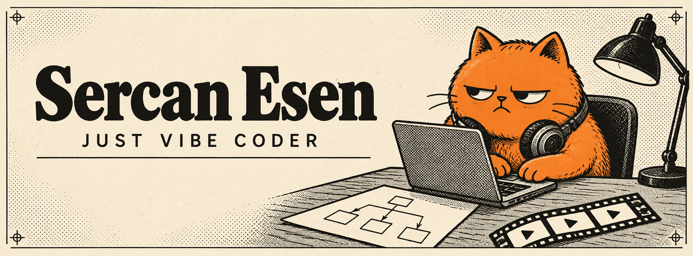

I'm Sercan, a vibe coder. I build small tools with AI agents to fix the things that slow me down, and I share them here.

## Start here

<table>
<tr>
<td width="50%" valign="top">

01 / VISUAL PLANNING

<h3><a href="https://github.com/Srcanesen/grillboard">grillboard</a></h3>

A visual interview board for AI coding agents. Click through questions while a decision tree, sketches, and a spec take shape.

<a href="https://github.com/Srcanesen/grillboard">See it →</a>

</td>
<td width="50%" valign="top">

02 / MEDIA TOOLS

<h3><a href="https://github.com/Srcanesen/ClipDock">ClipDock</a></h3>

Find and download media inside DaVinci Resolve Studio. Send it to the Media Pool, the playhead, or the end of the timeline.

<a href="https://github.com/Srcanesen/ClipDock">See it →</a>

</td>
</tr>
</table>
